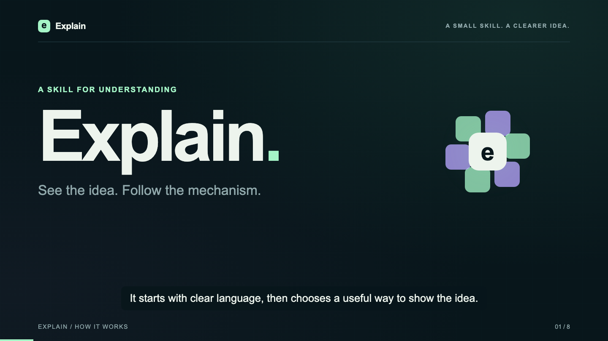

# Explain

**Clear technical English by default. Visuals when they help.**

A portable agent skill for Codex, Claude Code, and OpenCode. Explain starts with clear technical English, then chooses a useful format. A short question can stay a short answer. A system with meaningful choices can become an interactive page. A story over time can become a narrated film.

[Explore an example: Software factories](https://asunchu.github.io/explain/examples/software-factory/) · [Watch the film](https://asunchu.github.io/explain/#film) · [Read the skill](skills/explain/SKILL.md)

[Latest release: v0.2.0](https://github.com/asunchu/explain/releases/tag/v0.2.0) · [Release notes](CHANGELOG.md)

[](https://asunchu.github.io/explain/#film)

## Install

Run one command on macOS:

```sh
curl -fsSL https://raw.githubusercontent.com/asunchu/explain/main/install.sh | bash
```

From a local checkout, use:

```sh
bash install.sh
```

The installer configures Explain for Codex, Claude Code, and OpenCode. It sets up:

- One shared skill with compatible paths for all three harnesses.
- The `explain doctor` and `explain tools` terminal commands.
- Shared writing defaults and artifact routing in each harness's global instructions.
- A managed PATH block for Bash or Zsh.
- Locked Pele, Remotion, React, and local Kokoro dependencies.
- Verified speech models, a Python environment, and Chrome Headless Shell.
- FFmpeg and other missing system prerequisites through an existing supported package manager.

Automatic macOS prerequisite setup requires Homebrew. Bash and Zsh are supported.
Linux bootstrap support is experimental and has not passed a live Linux installation test.
Ubuntu and Debian hosts need Chrome Headless Shell libraries and working Python `venv` support.
See [Remotion's Linux dependencies](https://www.remotion.dev/docs/miscellaneous/linux-dependencies) before using the Linux bootstrap.
Linux setup uses configured Ubuntu or Debian apt repositories.
Those repositories must supply supported Node.js and Python versions. Privileged apt setup requires an existing non-interactive sudo session.
The installer does not install a package manager. Existing Codex, Claude Code, and OpenCode clients use the resulting shared setup.

Preview the installation without downloads or configuration changes:

```sh
bash install.sh --dry-run
```

Use `--core-only` to skip media preparation. It retains an existing runtime selection.
Use `--no-system-deps` when system prerequisites are managed separately.
Use `--model-cache /path/to/models` to reuse verified Kokoro model files.

Media tools pass an actual diagram, local speech synthesis, and a short video export before configuration changes begin.
Private backups protect existing instructions and aliases. Unrelated instruction text stays intact.
Rollback preserves detected concurrent edits and reports recovery conflicts. Uncatchable termination can still interrupt recovery.
Conflicting installations, extra package files, and invalid managed blocks stop installation before large downloads.
System package installations and downloaded caches remain outside configuration rollback.
Open a new terminal and start fresh harness sessions after installation.

For a lightweight skill-only installation with the [skills CLI](https://github.com/vercel-labs/skills), use:

```sh
npx skills add asunchu/explain --skill explain -g -a codex -a claude-code -a opencode
```

That command copies the skill. It does not perform the full toolchain setup above.
The existing [v0.2.0 ZIP](https://github.com/asunchu/explain/releases/download/v0.2.0/explain-skill.zip) predates the bundled doctor and installer.
Use an updated checkout for these tools until a new release archive is published.

## Check the installation

The complete skill includes the terminal launcher and setup tool. No repository checkout is required after installation.
Set `EXPLAIN_SKILL` to your installed skill directory, then run:

```sh
python3 "$EXPLAIN_SKILL/scripts/install-shortcuts.py" --dry-run
python3 "$EXPLAIN_SKILL/scripts/install-shortcuts.py"
```

Setup creates `~/.local/bin/explain`. Keep `~/.local/bin` on your `PATH`.
Skill installers copy the tools but do not run this setup automatically.
Use `--replace` to update a different existing symlink. Setup never replaces a regular file or directory.
See the bundled [installation guide](skills/explain/references/installation.md) for custom locations and moved installations.

```sh
explain doctor
explain doctor --fix --dry-run
explain doctor --fix
```

You can also run the check directly from a repository checkout:

```sh
python3 scripts/doctor.py --project /path/to/project
```

The report shows candidate skill paths, resolved symlinks, separate copies, and differences from its reference copy.
The default reference is the copy that owns the command. It checks consistency, not the latest published version.
It also compares marked writing defaults and checks their artifact routers.
Shared symlinks count as one installation. Separate copies remain separate, even when their files match.

Use `--harness codex`, `--harness claude-code`, or `--harness opencode` to narrow the check.
Use `--json` for a complete machine-readable report.
Use `--reference /path/to/skills/explain` to compare against another source copy.
Use `--skill-path /path/to/installed/explain` to include a custom installation.

The default check is read-only. It uses Python's standard library and makes no network or model calls.

To repair existing installations, preview the changes first:

```sh
python3 scripts/doctor.py --fix --dry-run
```

Apply the repair with private backups:

```sh
python3 scripts/doctor.py --fix
```

Repair uses the selected reference copy. It updates each shared installation once and preserves its symlink aliases.
It replaces only existing marked defaults blocks, including their artifact routers. Text outside those blocks stays unchanged.
Extra package files, dependency folders, and unmarked instructions stay unchanged.
Ambiguous copies, broken installations, and invalid markers block automatic repair.

Dry runs create no backups or target files. Applied repairs verify every backup before changing a destination.
Backups default to `$XDG_STATE_HOME/explain/backups`, or `~/.local/state/explain/backups` when unset.
Use `--backup-dir /path/to/backups` to select another parent directory.
Each run creates a private directory with original file contents and a `manifest.json` that records paths and hashes.
The command rejects stale plans and attempts rollback if a write fails. It then checks the repaired installation again.
It does not fetch releases or install runtime dependencies.

Exit codes: **0** means a clean check, a completed clean repair, or an unblocked dry run.
**1** means findings remain. **2** means invalid input, a blocked repair, or a repair failure.
Content fingerprints identify copies; the report does not infer an installed release version.
The Pele value comes from the package manifest and does not verify its installed runtime.

Candidate paths do not prove active loading. Plugin stores, enterprise policies, cloud skills, and session-added directories require separate inspection.
Unmarked instructions remain outside the comparison. The [adapter guide](adapters/README.md#installation-diagnostics) describes the checked locations.

## Try it

In Claude Code:

```text
/explain database indexes with a small example
/explain how software factories work using interactive HTML
/explain this architecture as a narrated video using local TTS
```

In Codex, use `$explain` instead of `/explain`. In OpenCode, ask the agent to use the `explain` skill.

You can also ask naturally: “Why do database indexes speed up reads but slow down writes?” or “Help me understand how software factories work.” You do not need to name the skill or choose a format first. Automatic skill selection depends on your harness and model; explicit invocation is a fallback when discovery misses.

| What needs explaining | Typical format |
| --- | --- |
| A definition or small concept | Plain language + example |
| Structure and relationships | Mermaid source rendered with Pele, or custom SVG |
| Cause and effect or alternative scenarios | Interactive HTML |
| A process over time or narrated story | Animated video |

An explicit format request takes precedence.

Standard diagrams use [Pele](https://pele.run/) through a pinned local renderer.
It keeps Mermaid source editable and exports SVG with links and images disabled.
Rendering runs in a disposable worker with resource limits and a deadline.
See the [diagram guide](skills/explain/references/diagrams.md) for commands and compatibility limits.
The [dated security review](security/pele-2026-10-18.md) records the package verification and integration controls.
Custom React/SVG remains available for illustrations and precise animation.

## Examples

- **[Software factory](examples/software-factory/):** one CSV-export feature travels through specification, implementation, verification, repair, human decisions, and release. Download its HTML and open it offline.
- **[Explain film](examples/explain-video/):** the skill explains its own workflow in a complete 2:17 video, with editable Remotion source, storyboard, transcript, captions, and local Kokoro narration. Speech API cost was $0; local compute is excluded.
- **[Pele diagram](examples/pele-diagram/):** a compact Home HQ architecture with themed SVG, a mobile-friendly PNG, and editable Mermaid source.

Default animation choices include Remotion, HTML/SVG with GSAP when useful, Motion Canvas, and Three.js for spatial concepts. The narration guide compares local Kokoro, low-cost hosted Kokoro, and premium voices. Prices are dated examples, not guarantees; check the provider before spending.

## Writing comes first

Explain uses **80% STE** for replies, explanations, teaching, and commit or PR text.
It uses **strict STE** for procedures, runbooks, safety text, UI copy, and error messages.
The user can choose either mode. “80%” names the relaxed style; it is not a measured score.

Both modes keep sentences short, use direct verbs, and preserve technical meaning.
Procedures allow 20 words per sentence. Descriptions allow 25 words.
The relaxed mode permits a familiar word when its replacement makes the text harder to read.

Read the [writing rules](skills/explain/RULES.md), [word guide](skills/explain/WORDS.md), and [video guide](skills/explain/VIDEO.md).
These are house rules inspired by ASD-STE100, not the complete official standard or dictionary.
Full compliance requires a separate check against the official sources.
Code, exact quotations, legal text, and technical names stay unchanged unless an edit is requested.
The user's language and style take precedence.

## Automatic use

The skill description covers technical explanations and visual artifacts. Global writing defaults cover ordinary replies. Codex's `agents/openai.yaml` explicitly allows implicit invocation (also its default). These make Explain eligible for automatic selection; they do not force an invocation. The main skill instructions are read after selection, so putting “always use me” inside them cannot solve discovery.

For always-on writing, put the [shared core](skills/explain/CORE.md) in your harness's global or project instructions.
For automatic artifact loading, also include a router that names the exact installed skill directory.
From a local checkout, run:

```sh
python3 scripts/sync-defaults.py /path/to/AGENTS.md --skill-path /path/to/skills/explain
```

Use `CLAUDE.md` for Claude Code. The script replaces its marked block and preserves other instructions.
The router loads the local entrypoint for diagrams, interactive explanations, storyboards, and video plans.
It avoids selecting a different global copy with the same name. Repeat synchronization after updating or moving the installation.
The [harness adapter guide](adapters/README.md) lists the instruction locations and tool mapping.
The full installer updates the global instruction files with managed Explain blocks.
The skills CLI and manual file copies do not update those instructions. Automatic model selection still varies.

The shared core preserves meaning before shortening text. It also chooses evidence sources:

- Read local code and project documents for local behavior.
- Use Context7 when it provides relevant library documentation for the requested version.
- Otherwise, use official documentation or search that leads to primary sources.
- Skip unnecessary research for rewrites and basic arithmetic.

Context7 is optional. No connector, API key, or research skill is required by the package.
When verification is unavailable, Explain should preserve uncertainty and state the limit.
These are instructions, not a guarantee of model behavior.

After changing the installed description, start a fresh session or reload skills as supported by your harness. Test ordinary prompts without `/explain`, `$explain`, or “use Explain,” and inspect the skill-load trace. The [discovery evaluations](evals/README.md) test this separately from explicitly invoked behavior. See the official [Codex](https://developers.openai.com/codex/skills/), [Claude Code](https://code.claude.com/docs/en/skills), and [OpenCode](https://opencode.ai/docs/skills) documentation for discovery behavior.

## Compatibility and verification

The skill follows the [Agent Skills format](https://agentskills.io/specification) and uses ordinary file, shell, browser, and HTTP capabilities; no specific MCP server is required.

The examples were created in Codex. The HTML's routes and mobile layout were tested in a browser. The video was decoded and checked for codecs, timing, captions, and audio clipping; representative frames were visually reviewed. No independent listening audition was performed. Behavioral results depend on the model, loaded instructions, and available tools; installation alone does not establish compatibility. The video build commands target macOS/Linux.

### Clean cloud test

On October 3, 2026, a fresh GitHub-hosted Ubuntu 24.04 runner installed the public skill using `skills@1.7.0` for Codex, Claude Code, and OpenCode. All four skill files matched the repository for each target. The installer used the shared `~/.agents/skills/explain` location for Codex/OpenCode and a Claude Code symlink.

The earlier film's cloud test installed the pinned video dependencies and rendered its cache-example scene: 12.181 seconds, 1920×1080, 30 fps, H.264/AAC. Full media decoding passed. [Run and downloadable evidence](https://github.com/asunchu/explain/actions/runs/37154632292).

This is an installation and existing-example rendering test, not an AI-agent behavioral evaluation or a fresh TTS synthesis test. It ran in an ephemeral GitHub cloud runner, not an OpenAI cloud sandbox. Maintainers can repeat it through the **Cloud installation and render smoke test** workflow in Actions.

## Contribute

### Behavioral evaluations

The [evaluation suite](evals/README.md) contains 23 cases for STE writing, format selection, explicit overrides, explanation accuracy, working HTML/video, local TTS, spending boundaries, and automatic discovery. Prepare isolated trials for Codex, Claude Code, or OpenCode, retain their outputs, and score observable behavior against the supplied rubrics. Reports distinguish passed, failed, blocked, and unrun cases.

CI validates the cases and reporting code; it does **not** run AI harnesses or prove behavioral compatibility. See the evaluation guide for running and reviewing actual trials.
The [paired default experiment](evals/paired-defaults.md) separates instruction following from automatic skill discovery and factual grounding.
See the [paired results](evals/reports/2026-10-15-grounded-defaults.md) for the tested models, observed improvements, and remaining failures.

See [CONTRIBUTING.md](CONTRIBUTING.md). Useful contributions include clear examples, format-selection evaluations, portability fixes, and updated provider references. Run `python3 scripts/validate.py` before opening a pull request.

## License and inspiration

MIT for the original skill, source, and examples. Dependencies retain their own licenses; see [THIRD_PARTY.md](THIRD_PARTY.md). Inspired by [Andrej Karpathy's post on explanation formats](https://x.com/karpathy/status/2105819303471976479). No affiliation or endorsement is implied.
